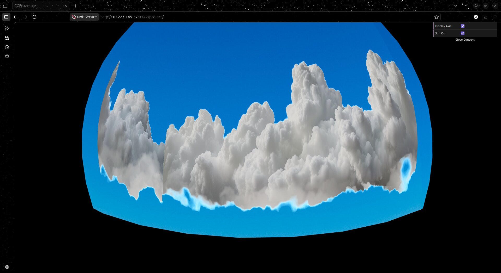
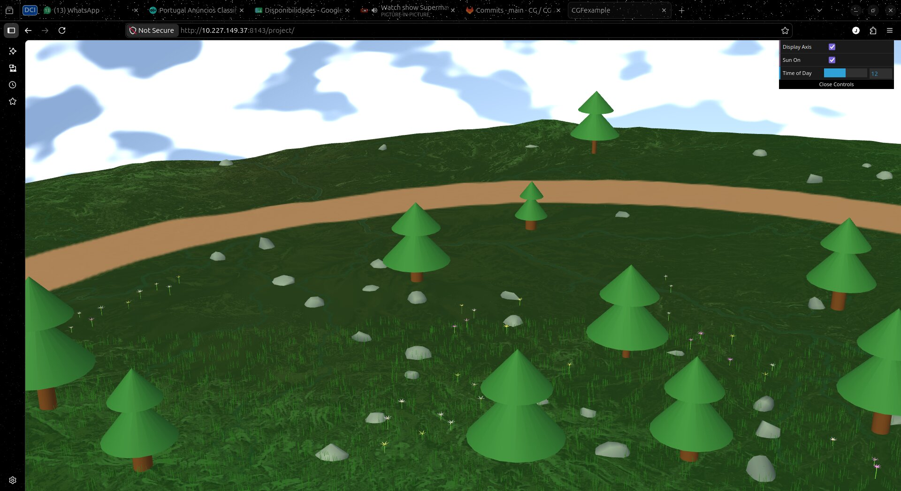
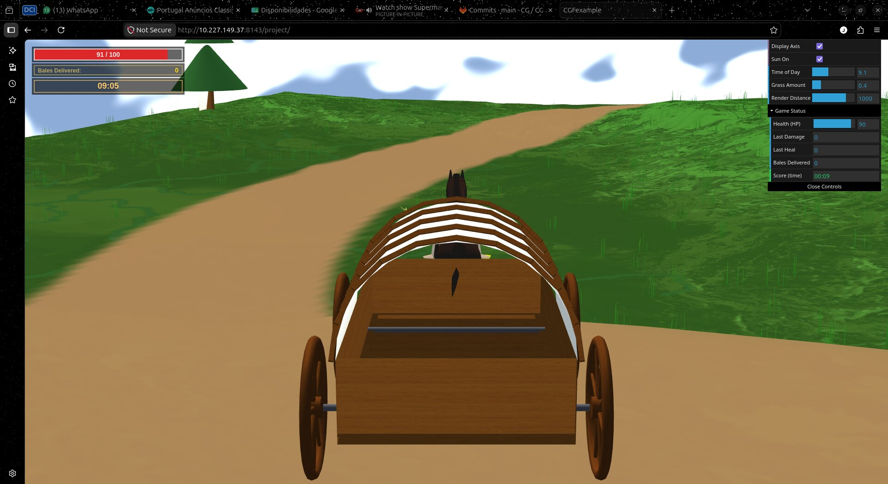
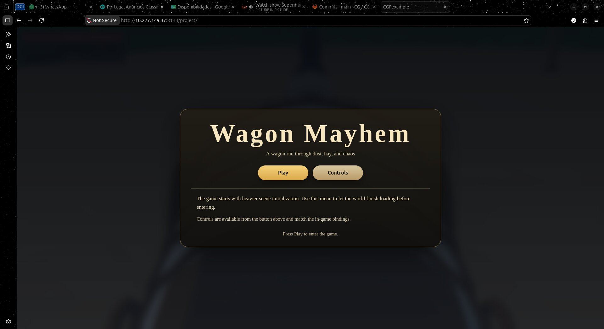

# Wagon Mayhem

A 3D survival game that runs in the browser, built with **WebGL** and **GLSL** shaders. The player drives a covered wagon across a spring prairie, collects hay bales, avoids rocks and trees, and delivers the bales to the barn to recover health.

Built by a team of 2 as the final project of the Computer Graphics course (L.EIC, FEUP, 2025/26). Project grade: **16.1/20**.

<p align="center">
  <a href="https://youtu.be/6B_4PcfygfA">
    
  </a>
  <br>
  <a href="https://youtu.be/6B_4PcfygfA"><b>▶ Watch the gameplay video</b></a>
</p>

## Highlights

- **Procedural world**: height-mapped terrain, Poisson-disc placement of trees and rocks, and procedural flowers with configurable stems, petals and colours
- **Custom shaders**: animated grass driven by a time uniform in GLSL, sky dome with drifting clouds and warm directional sunlight
- **Hierarchical wagon model** with body, cover, wheels that rotate with speed, and an imported horse model
- **Custom OBJ/MTL loader** with material support and vertex deduplication
- **Performance work**: distance culling, level of detail for grass, and object pooling to reduce garbage collection in the render loop
- **Gameplay loop**: hay bale collection and delivery, collisions, health, score, game over and several camera modes

| | |
|---|---|
|  |  |
|  |  |

## My contribution

- Built the **wagon**: the hierarchical model, the driver's bench and the wood texture
- Implemented the **WASD movement** of the wagon
- Added **interface (GUI) elements** for the game

## Tech stack

JavaScript, WebGL, GLSL, WebCGF (FEUP's WebGL framework), dat.GUI

## Running locally

Serve the repository root with any static web server and open `project/index.html`:

```bash
npx http-server .
# then open http://localhost:8080/project/
```

| Key | Action |
|---|---|
| W / A / S / D | Accelerate, steer and brake |
| P / L | Pick up a hay bale / drop it in the barn |
| Shift | Change camera mode |
| R | Restart after game over |

The full technical write-up (development phases, OBJ loader, object pooling, procedural placement and shaders) is in [project/README.md](project/README.md).

## Team

António Miller, José Reis
